# Oscilloscope capture gallery

[Return to measurement report](../measurements.md) · [Plain-English explanation guide](understanding-the-measurements.md)

All 31 PNG display copies are lossless conversions of the intact BMP files. Original BMP files are preserved in `originals/`. The archive GIF entries are empty and are not included. Original directory names are evidence labels, not independently verified settings. See the [manifest](data/screenshot-manifest.csv) for original paths and SHA-256 checksums.

## pic_59_2

Original archive path: `Bypass_250mvpp_100hz_dt/pic_59_2.bmp`

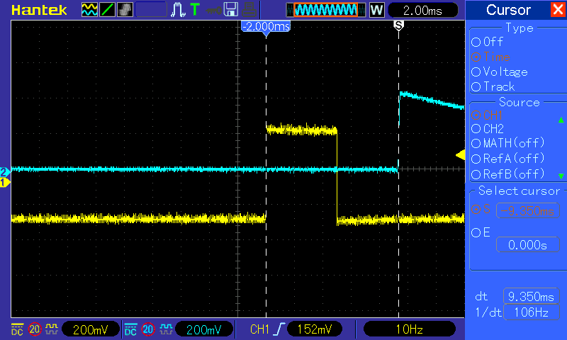

**How to read this capture:** The cursor interval is 9.350 ms. The folder says 100 Hz, while the screen shows 10 Hz. The roughly 106 Hz reciprocal-cursor value is 1 divided by 9.350 ms, not a separate measurement of generator frequency. The input/output event pairing remains a preliminary latency observation.

## pic_59_3

Original archive path: `Bypass_250mvpp_10hz_dt_end to end latency/pic_59_3.bmp`

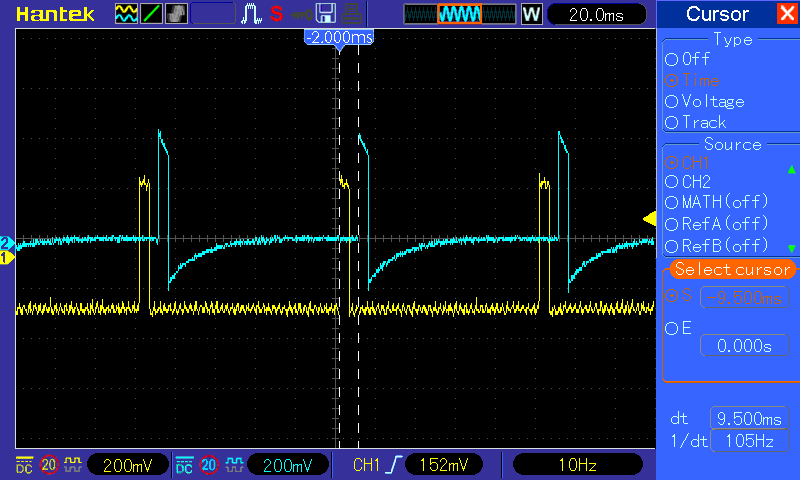

**How to read this capture:** The cursor interval is 9.500 ms between selected input/output features. The longer time window makes event separation more visible than the 1 kHz capture, but the exact firmware and repeatability still need confirmation. Do not combine this with the delay-only offsets as if all captures use one configuration.

## pic_58_1

Original archive path: `Bypass_250mvpp_1khz/pic_58_1.bmp`

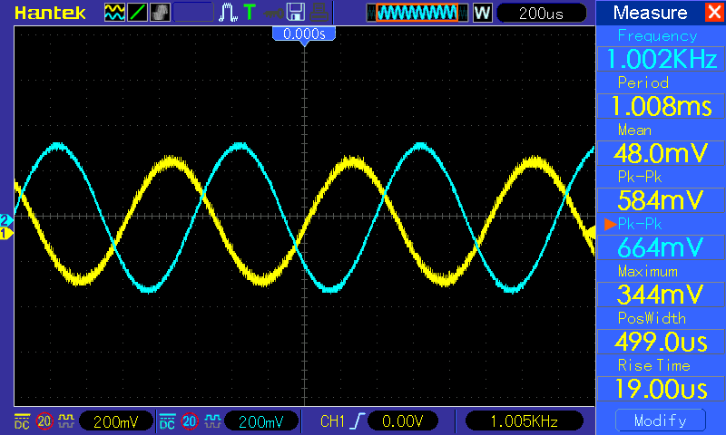

**How to read this capture:** Compare the yellow input and cyan output peak-to-peak readouts: 584 and 664 mV. Dividing them gives about +1.12 dB. Both channels use 200 mV/div here. The horizontal displacement is phase alignment of periodic sine waves and must not be used alone as absolute latency. This capture differs from the 580 mV input recorded in the sweep table.

## pic_59_1

Original archive path: `Bypass_250mvpp_1khz_dt_345us/pic_59_1.bmp`

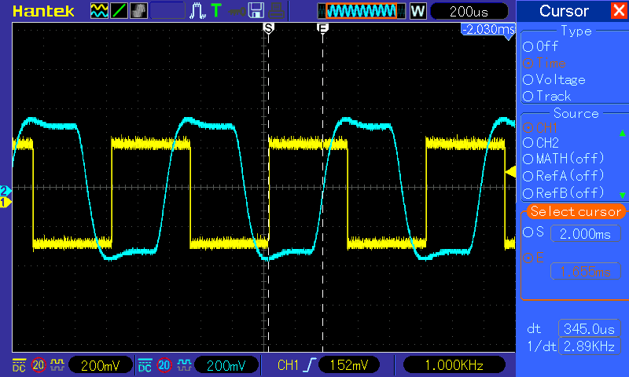

**How to read this capture:** The selected rising features are 345 µs apart. At about 1 kHz, a full period is 1 ms, so the nearby input/output edges need not belong to the same original event. Read this as periodic edge separation, not proven total system latency.

## pic_60_1

Original archive path: `Bypass_SNR/pic_60_1.bmp`

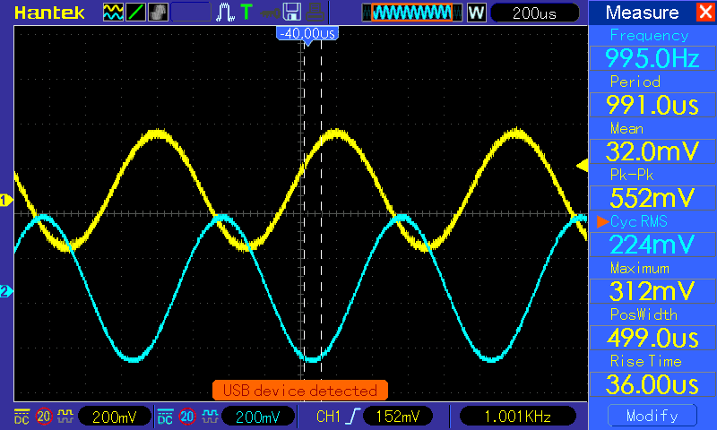

**How to read this capture:** The CH2 Cycle RMS signal reading is 224 mV. It was used with the separate 5.20 mV noise reading to calculate an indicative 32.68 dB ratio. This image alone does not establish SNR because the noise acquisition conditions must also match.

## pic_62_29

Original archive path: `C1/pic_62_29.bmp`

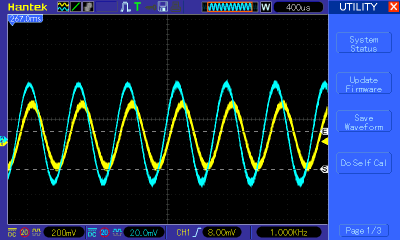

**How to read this capture:** C1 displays input and wet-only chorus output at one moment. The channels have different voltage scales, so trace height alone is not a gain comparison. The window is much shorter than the programmed two-second modulation period; no full LFO cycle or absolute 15–25 ms delay range can be measured here.

## pic_62_15

Original archive path: `DELAY_DECAY_0.75/pic_62_15/pic_62_15.bmp`

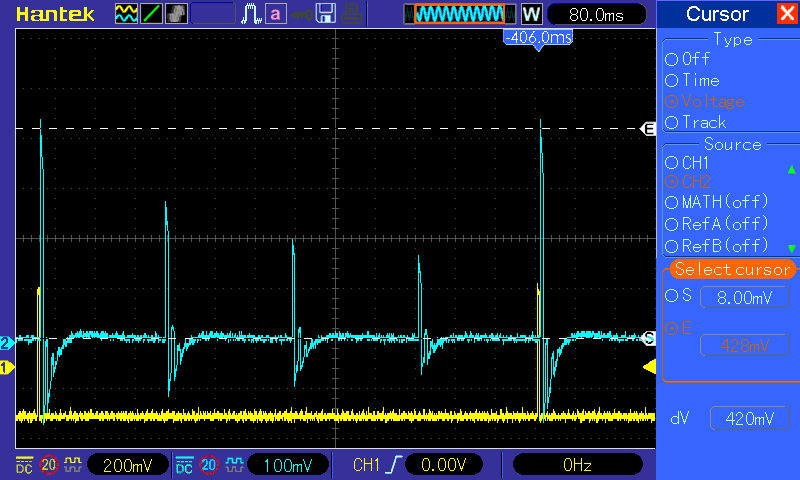

**How to read this capture:** The folder identifies feedback 0.75. The voltage cursor separation selects the baseline-to-positive-peak height of the dry output pulse: 420 mV. This is a pulse peak amplitude, not Vpp. Use this as the dry reference for the first-echo/dry comparison; it is not an echo in the feedback-ratio calculation.

## pic_62_16

Original archive path: `DELAY_DECAY_0.75/pic_62_16/pic_62_16.bmp`

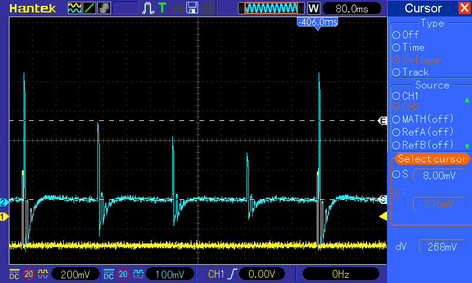

**How to read this capture:** The folder identifies feedback 0.75. The voltage cursor separation selects the baseline-to-positive-peak height of the echo 1: 268 mV. This is a pulse peak amplitude, not Vpp. Compare successive echo heights to estimate feedback. The first echo also depends on the dry/wet mixer coefficients. Filtered pulse shape and separate acquisitions limit exact agreement.

## pic_62_17

Original archive path: `DELAY_DECAY_0.75/pic_62_17/pic_62_17.bmp`

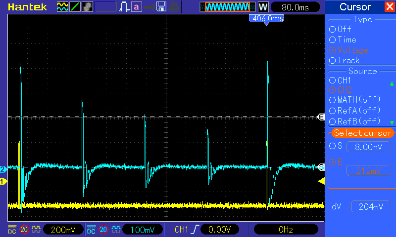

**How to read this capture:** The folder identifies feedback 0.75. The voltage cursor separation selects the baseline-to-positive-peak height of the echo 2: 204 mV. This is a pulse peak amplitude, not Vpp. Compare successive echo heights to estimate feedback. The first echo also depends on the dry/wet mixer coefficients. Filtered pulse shape and separate acquisitions limit exact agreement.

## pic_62_18

Original archive path: `DELAY_DECAY_0.75/pic_62_18/pic_62_18.bmp`

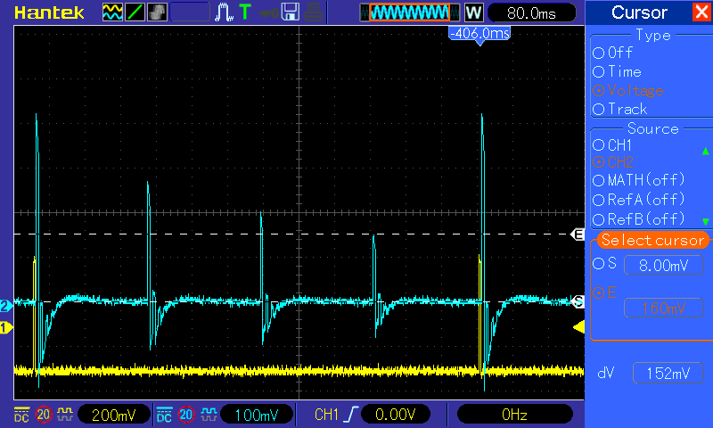

**How to read this capture:** The folder identifies feedback 0.75. The voltage cursor separation selects the baseline-to-positive-peak height of the echo 3: 152 mV. This is a pulse peak amplitude, not Vpp. Compare successive echo heights to estimate feedback. The first echo also depends on the dry/wet mixer coefficients. Filtered pulse shape and separate acquisitions limit exact agreement.

## pic_62_11

Original archive path: `Delay_DECAY_0.25/pic_62_11/pic_62_11.bmp`

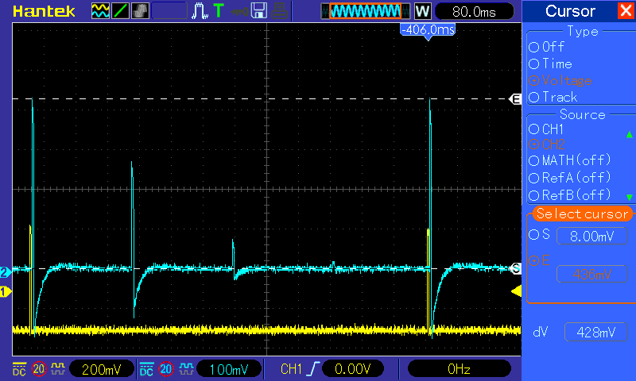

**How to read this capture:** The folder identifies feedback 0.25. The voltage cursor separation selects the baseline-to-positive-peak height of the dry output pulse: 428 mV. This is a pulse peak amplitude, not Vpp. Use this as the dry reference for the first-echo/dry comparison; it is not an echo in the feedback-ratio calculation.

## pic_62_12

Original archive path: `Delay_DECAY_0.25/pic_62_12/pic_62_12.bmp`

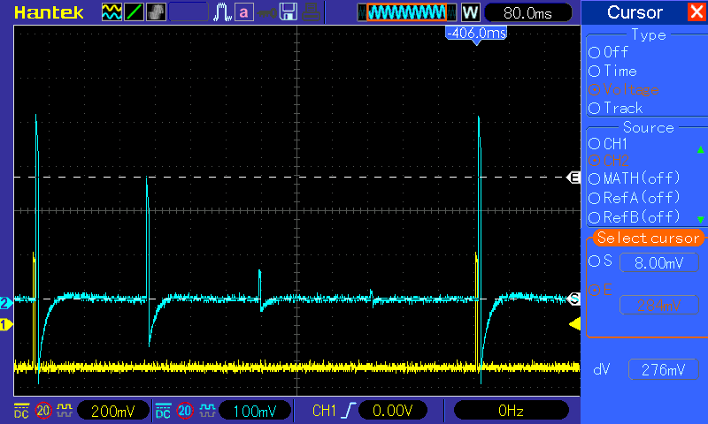

**How to read this capture:** The folder identifies feedback 0.25. The voltage cursor separation selects the baseline-to-positive-peak height of the echo 1: 276 mV. This is a pulse peak amplitude, not Vpp. Compare successive echo heights to estimate feedback. The first echo also depends on the dry/wet mixer coefficients. Filtered pulse shape and separate acquisitions limit exact agreement.

## pic_62_13

Original archive path: `Delay_DECAY_0.25/pic_62_13/pic_62_13.bmp`

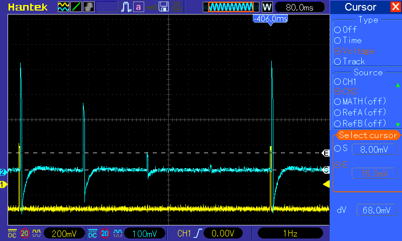

**How to read this capture:** The folder identifies feedback 0.25. The voltage cursor separation selects the baseline-to-positive-peak height of the echo 2: 68 mV. This is a pulse peak amplitude, not Vpp. Compare successive echo heights to estimate feedback. The first echo also depends on the dry/wet mixer coefficients. Filtered pulse shape and separate acquisitions limit exact agreement.

## pic_62_14

Original archive path: `Delay_DECAY_0.25/pic_62_14/pic_62_14.bmp`

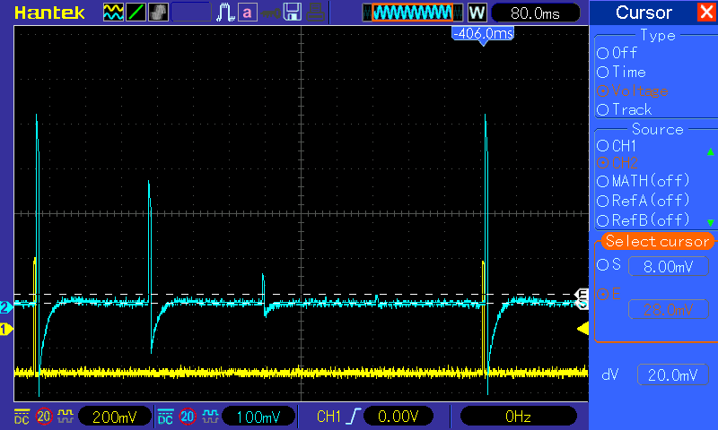

**How to read this capture:** The folder identifies feedback 0.25. The voltage cursor separation selects the baseline-to-positive-peak height of the echo 3: 20 mV. This is a pulse peak amplitude, not Vpp. Compare successive echo heights to estimate feedback. The first echo also depends on the dry/wet mixer coefficients. Filtered pulse shape and separate acquisitions limit exact agreement.

## pic_62_10

Original archive path: `Delay_DECAY_0.5/pic_62_10/pic_62_10.bmp`

**How to read this capture:** The folder identifies feedback 0.50. The voltage cursor separation selects the baseline-to-positive-peak height of the echo 3: 72 mV. This is a pulse peak amplitude, not Vpp. Compare successive echo heights to estimate feedback. The first echo also depends on the dry/wet mixer coefficients. Filtered pulse shape and separate acquisitions limit exact agreement.

## pic_62_7

Original archive path: `Delay_DECAY_0.5/pic_62_7/pic_62_7.bmp`

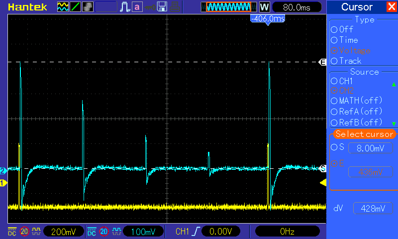

**How to read this capture:** The folder identifies feedback 0.50. The voltage cursor separation selects the baseline-to-positive-peak height of the dry output pulse: 428 mV. This is a pulse peak amplitude, not Vpp. Use this as the dry reference for the first-echo/dry comparison; it is not an echo in the feedback-ratio calculation.

## pic_62_8

Original archive path: `Delay_DECAY_0.5/pic_62_8/pic_62_8.bmp`

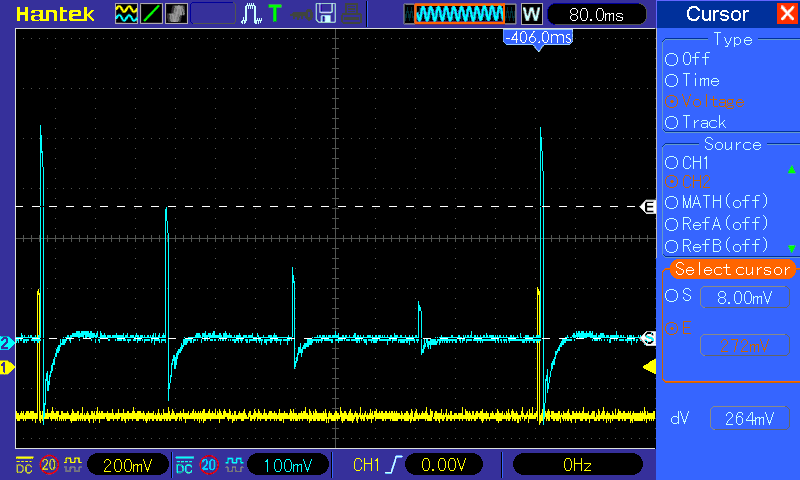

**How to read this capture:** The folder identifies feedback 0.50. The voltage cursor separation selects the baseline-to-positive-peak height of the echo 1: 264 mV. This is a pulse peak amplitude, not Vpp. Compare successive echo heights to estimate feedback. The first echo also depends on the dry/wet mixer coefficients. Filtered pulse shape and separate acquisitions limit exact agreement.

## pic_62_9

Original archive path: `Delay_DECAY_0.5/pic_62_9/pic_62_9.bmp`

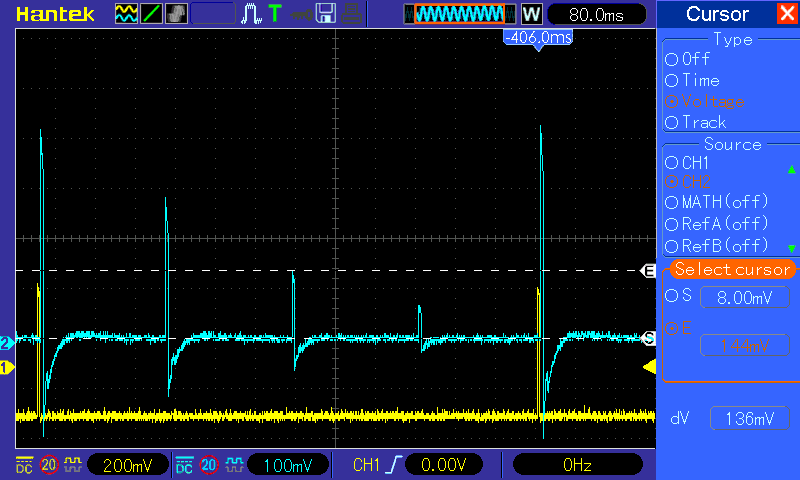

**How to read this capture:** The folder identifies feedback 0.50. The voltage cursor separation selects the baseline-to-positive-peak height of the echo 2: 136 mV. This is a pulse peak amplitude, not Vpp. Compare successive echo heights to estimate feedback. The first echo also depends on the dry/wet mixer coefficients. Filtered pulse shape and separate acquisitions limit exact agreement.

## pic_62_2

Original archive path: `Delay_Effect_100ms_input_toDelayed_signal/pic_62_2.bmp`

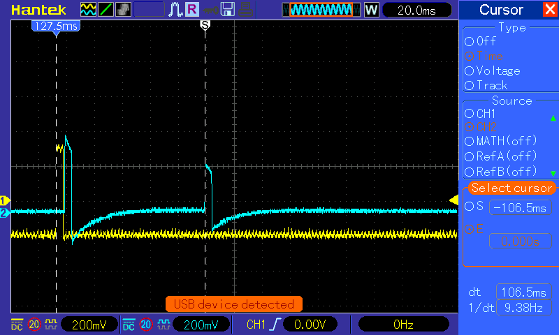

**How to read this capture:** For the nominal 100 ms setting, the input-to-echo interval is 106.5 ms. It includes the initial signal-path offset as well as the programmed echo spacing. Compare with pic_62_3.

## pic_62_3

Original archive path: `Delay_Effect_100ms_output_to_delayed_signal/pic_62_3.bmp`

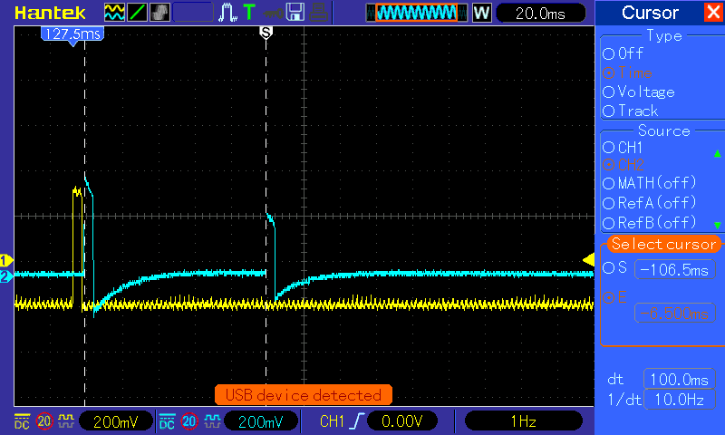

**How to read this capture:** The time cursors select the dry output and first echo on CH2. Their spacing is 100.0 ms, supporting the programmed 100 ms interval at the displayed resolution. The 1/dt reading of 10 Hz is only the reciprocal of this echo interval.

## pic_62_4

Original archive path: `Delay_Effect_250ms_output_to_delayed_signal/pic_62_4.bmp`

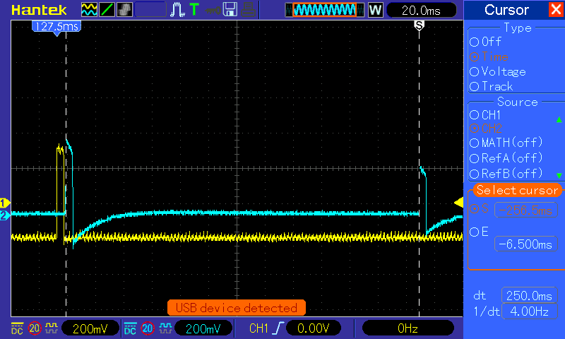

**How to read this capture:** The time cursors select the dry output and first echo. Their spacing is 250.0 ms. Subtracting it from the separate 256.5 ms input-to-echo reading gives an approximate 6.5 ms offset, subject to acquisition and cursor uncertainty.

## pic_62_5

Original archive path: `Delay_Effect_500ms_input_toDelayed_signal/pic_62_5.bmp`

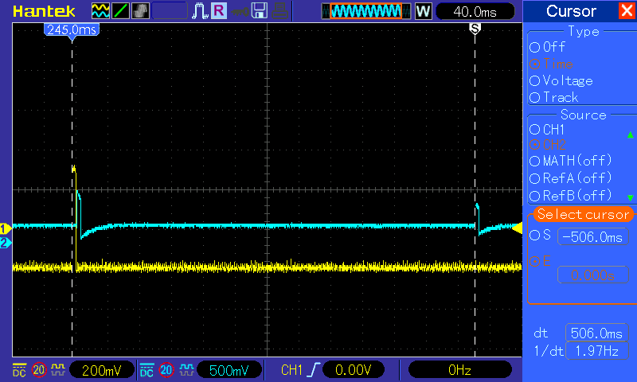

**How to read this capture:** For the nominal 500 ms setting, the input-to-echo interval is 506.0 ms. This should not be reported as a 6 ms error in the delay setting: it includes the path before the dry output.

## pic_62_6

Original archive path: `Delay_Effect_500ms_output_to_delayed_signal/pic_62_6.bmp`

**How to read this capture:** The dry-output-to-echo interval is 500.0 ms. Comparing this with pic_62_5 gives an inferred 6.0 ms offset. Manual cursors support displayed agreement, not exact sample-level accuracy.

## pic_62_1

Original archive path: `Delay_effect_250ms/pic_62_1.bmp`

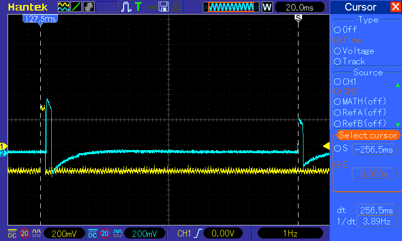

**How to read this capture:** For the nominal 250 ms setting, the selected input-to-echo interval is 256.5 ms. This includes the system offset before the dry output appears. Compare with pic_62_4, which selects dry output to echo instead.

## pic_62_26

Original archive path: `REVERB/R1/pic_62_26.bmp`

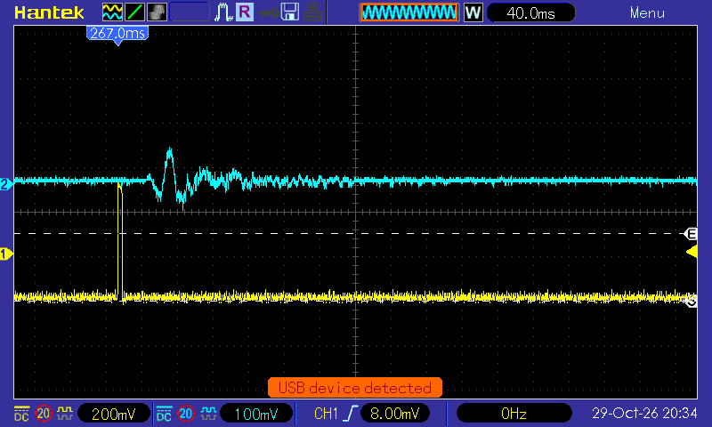

**How to read this capture:** R1 uses room-size parameter 0.2 and damping 0.3. The short yellow excitation is followed by a cyan wet-only tail. Compare R1–R3 to examine persistence while damping stays fixed. R1 appears shorter-lived and R3 persists longer in the saved window. Neither the parameter nor the visible tail gives a measured physical room size or validated RT60.

## pic_62_27

Original archive path: `REVERB/R2/pic_62_27.bmp`

**How to read this capture:** R2 uses room-size parameter 0.5 and damping 0.3. The short yellow excitation is followed by a cyan wet-only tail. Compare R1–R3 to examine persistence while damping stays fixed. R1 appears shorter-lived and R3 persists longer in the saved window. Neither the parameter nor the visible tail gives a measured physical room size or validated RT60.

## pic_62_28

Original archive path: `REVERB/R3/pic_62_28.bmp`

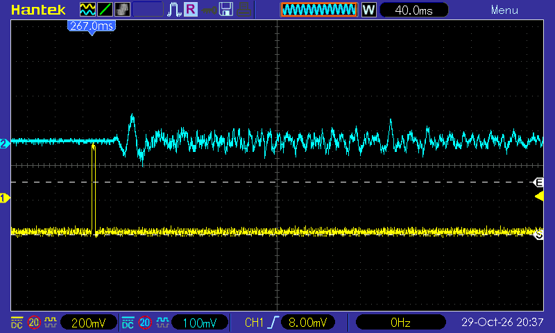

**How to read this capture:** R3 uses room-size parameter 0.9 and damping 0.3. The short yellow excitation is followed by a cyan wet-only tail. Compare R1–R3 to examine persistence while damping stays fixed. R1 appears shorter-lived and R3 persists longer in the saved window. Neither the parameter nor the visible tail gives a measured physical room size or validated RT60.

## pic_62_23

Original archive path: `REVERB/R4/pic_62_23.bmp`

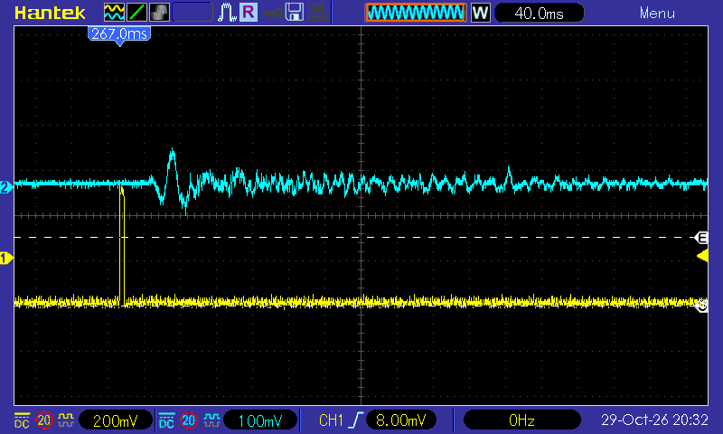

**How to read this capture:** R4 uses room-size parameter 0.7 and damping 0.1. The short yellow excitation is followed by a cyan wet-only tail. Compare R4–R6 to investigate damping at fixed room size. The waveform does not separately display frequency bands, so it cannot by itself quantify high-frequency decay. Neither the parameter nor the visible tail gives a measured physical room size or validated RT60.

## pic_62_24

Original archive path: `REVERB/R5/pic_62_24.bmp`

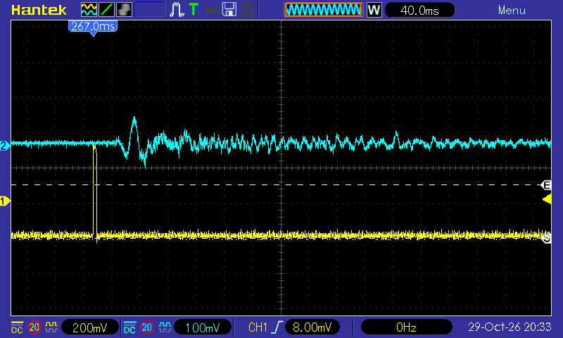

**How to read this capture:** R5 uses room-size parameter 0.7 and damping 0.5. The short yellow excitation is followed by a cyan wet-only tail. Compare R4–R6 to investigate damping at fixed room size. The waveform does not separately display frequency bands, so it cannot by itself quantify high-frequency decay. Neither the parameter nor the visible tail gives a measured physical room size or validated RT60.

## pic_62_25

Original archive path: `REVERB/R6/pic_62_25.bmp`

**How to read this capture:** R6 uses room-size parameter 0.7 and damping 0.9. The short yellow excitation is followed by a cyan wet-only tail. Compare R4–R6 to investigate damping at fixed room size. The waveform does not separately display frequency bands, so it cannot by itself quantify high-frequency decay. Neither the parameter nor the visible tail gives a measured physical room size or validated RT60.

## pic_59_4

Original archive path: `noice_floor/pic_59_4.bmp`

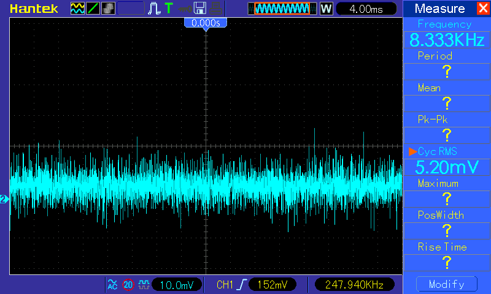

**How to read this capture:** Read the 5.20 mV Cycle RMS value on CH2. The irregular cyan trace is the noise observation; the displayed automatic frequency is not a dependable noise-frequency measurement. An unknown bandwidth and cycle-based RMS prevent treating this as a validated audio noise floor.
