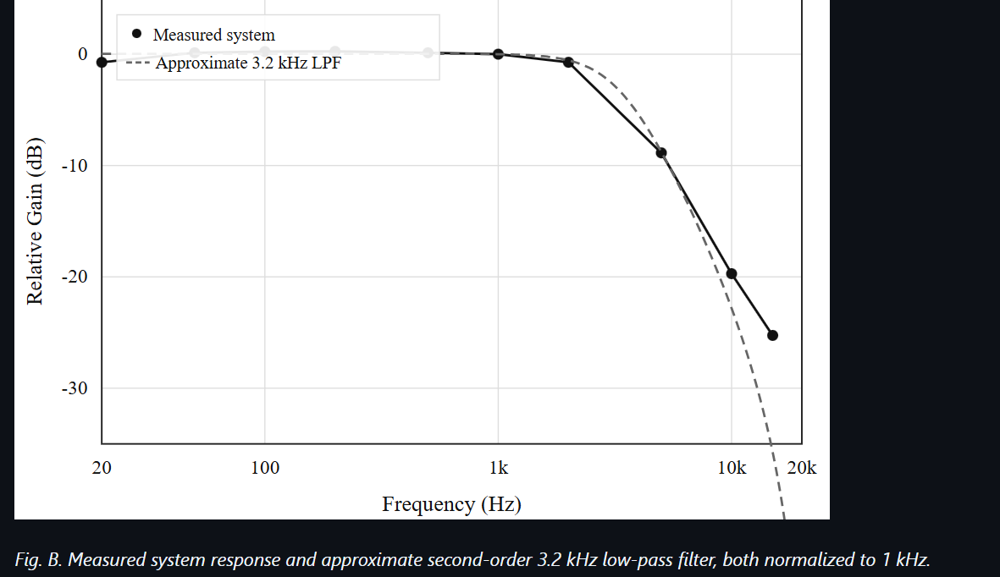
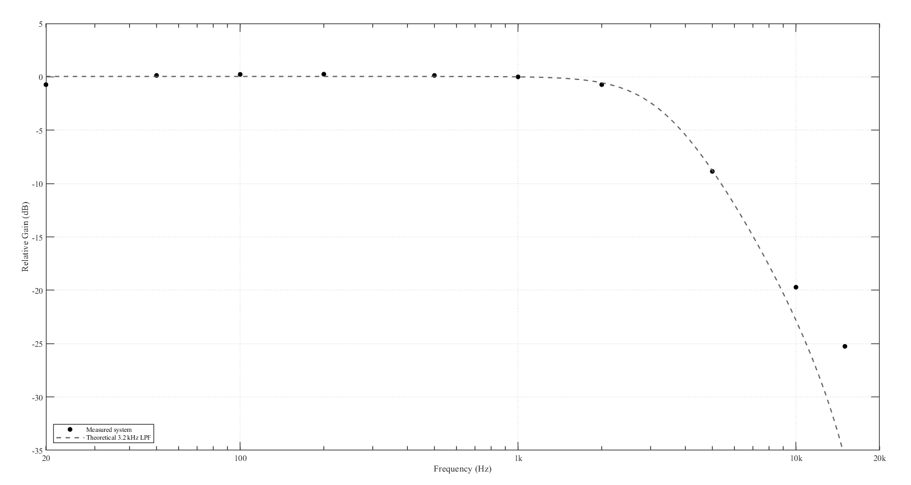

# Frequency-response comparison

*Measured system response and approximate second-order 3.2 kHz low-pass filter, both normalized to 1 kHz.*

*Full plot of the measured system response and the theoretical 3.2 kHz low-pass filter comparison.*
