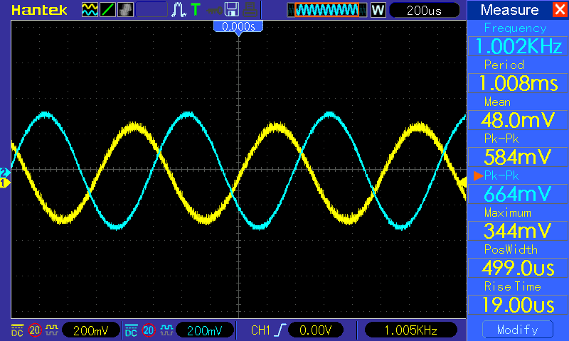
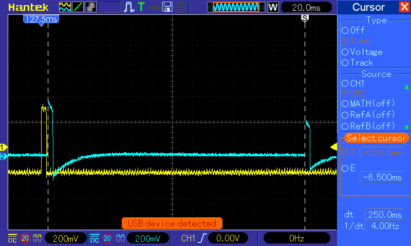
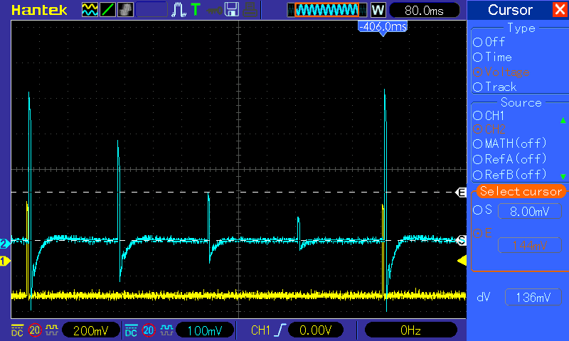
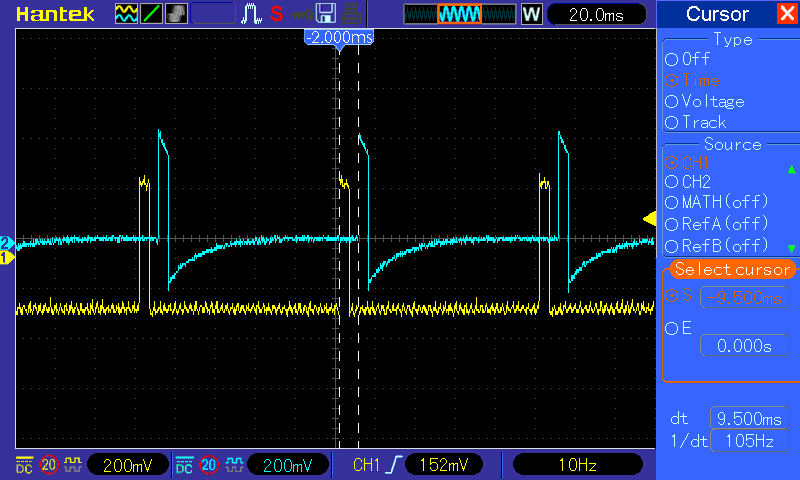
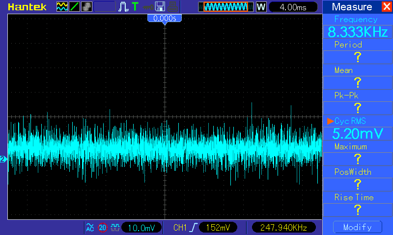
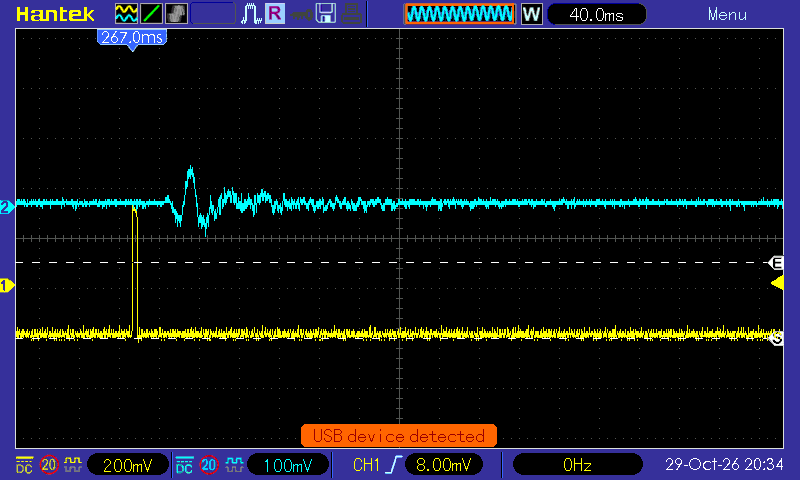
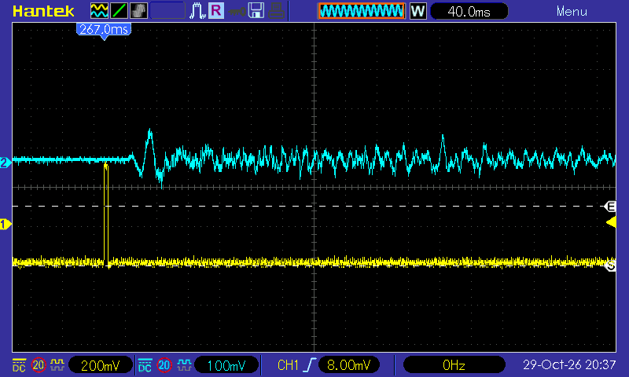
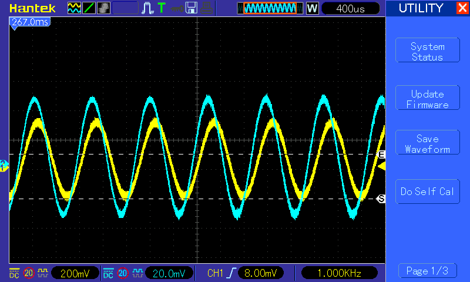

# DSP Guitar MultiFX — Experimental Measurements

**Status:** Preliminary experimental characterization  
**Documentation date:** 30 October 2026  
**Suggested repository location:** `Docs/measurements.md`

This report records frequency response, harmonic readings, delay timing and feedback, latency, noise, reverb configurations, and chorus settings. It distinguishes measured observations, calculations, and predictions from firmware. Preliminary values must not be presented as validated product specifications.

## How to use this report

Start with the [plain-English explanation guide](Measurements/understanding-the-measurements.md) for definitions, worked calculations and interpretation. The [capture gallery](Measurements/capture-gallery.md) explains each of the 31 screenshots individually. Return here for the complete numerical record and methodology disclosures.

## 1. Evidence and scope

This document consolidates the measurement review and values supplied during testing. All 31 oscilloscope captures were extracted from `DSP_data(2).rar` and visually reviewed for this illustrated edition. The archive contains 31 intact BMP captures and empty GIF entries, not raw waveform samples. This package preserves the original BMP files and includes lossless PNG display copies. No cropping, annotation, or pixel alteration was applied. Numerical results retain the earlier transcriptions; selected screenshots were checked at full resolution. No FFT capture is included.

See the [complete capture gallery](Measurements/capture-gallery.md) and [filename/checksum manifest](Measurements/data/screenshot-manifest.csv).

The effects-off sketch subsequently supplied as [the archived original paste](Measurements/firmware-reference/effects-off-original-paste.md) was inspected directly. The experimenter confirmed that this sketch, with all effects switched OFF, produced the frequency-response sweep. The R1–R6 reverb parameter mapping was also supplied subsequently.

These results describe the experimental sketches and operating states recorded here. They must not automatically be attributed to the latest repository firmware.

### Equipment and operating settings

| Item | Configuration |
|---|---|
| Processor | Teensy 4.1 |
| Audio codec | SGTL5000 audio shield |
| Nominal sample rate | 44.1 kHz |
| Audio block size | 128 samples |
| Oscilloscope | Hantek MSO5102D |
| Signal generator | UNI-T UTG4082A |
| Codec input | Line input |
| Input-level setting | `lineInLevel(9)` |
| Volume setting | `volume(0.7)` |
| Experimental audio allocation | `AudioMemory(300)` |

The physical output used (line output or headphone output), output load, probe attenuation, and acquisition bandwidth still need to be recorded. Do not interpret `volume(0.7)` as a universal end-to-end voltage gain.

## Measurement method and disclosure

This is a retrospective test record. The procedure below separates visible evidence and experimenter-supplied settings from details that were not recorded. It is not a claim that a calibrated audio-analyzer protocol was followed.

### Common measurement arrangement

A UNI-T UTG4082A supplied the test signal to the pedal. Oscilloscope CH1 (yellow) represented the input and CH2 (cyan) the output, as identified by the experimenter and used in the reviewed captures. The signal generator's displayed amplitude is not substituted for the measured input Vpp. Exact probe locations (external pedal jacks versus codec connections), probe factors, generator output-load setting, cable/loading arrangement, and physical output connector remain unconfirmed. Therefore these data cannot isolate the analog front-end from the codec.

Some archive folders say `250mvpp`, but the approximately 1 kHz capture actually reads CH1 = 584 mVpp. Folder labels must not override screen readings; whether those labels refer to a generator setting or an earlier condition is unknown.

### How each result was obtained

| Test | Applied signal / configuration | Reading method used | Missing information or limitation |
|---|---|---|---|
| Frequency response | Sinusoid at each listed frequency; all three effects OFF; shared 3.2 kHz pre-filter retained | Record CH1 and CH2 peak-to-peak voltages; calculate 20 log10(Vout/Vin) separately at every frequency | Sweep values supplied as a table; only the separate approximately 1 kHz capture is in this archive. Settling time, averaging, exact input level control and repeat count were not logged |
| Harmonics | Reported 1 kHz sinusoid | Manual FFT level readings for H1–H4; subtract H1 in dB and combine harmonic powers relative to H1 | No FFT screenshot, window, record length, reference units, or generator baseline available |
| Delay timing | Brief input pulses visible in CH1; dry-plus-wet output in CH2; 100/250/500 ms settings | Place time cursors on corresponding input/echo or dry/echo features; read delta time | Exact pulse width and cursor threshold not standardized; cursor intervals are not sample-level estimates |
| Delay feedback | Pulse excitation; feedback folder labels 0.25, 0.50 and 0.75 | Place CH2 voltage cursors at baseline and successive positive pulse peaks; divide echo amplitudes | Each cursor image is a separate acquisition; filtering changes pulse shape; amplitudes are not Vpp |
| Latency | Periodic square-wave/low-rate pulse captures with input and output visible | Read time cursor separation between selected rising features | Periodic ambiguity, firmware attribution and consistent threshold remain unresolved |
| Signal/noise ratio | Signal-present sinusoid capture and separate noise capture | Divide displayed CH2 Cycle RMS readings, 224 mV and 5.20 mV, then use 20 log10 | Input termination and bandwidth undocumented; Cycle RMS/coupling differ; indicative ratio only |
| Reverb | Brief input pulse; wet-only output; R1–R6 settings | Inspect output persistence after excitation, comparing time and voltage scales | No fitted decay curve or RT60; excitation duration/amplitude and capture repeat count not recorded |
| Chorus | Approximately 1 kHz sinusoid; wet-only modulated-delay sketch | Short input/output waveform capture for qualitative inspection | Capture too short to measure the two-second LFO period; no measured depth/rate reported |

### Examples of acquisition settings visible on the saved screens

| Capture | Displayed horizontal scale | CH1 / CH2 vertical scale | Visible measurement |
|---|---|---|---|
| `pic_58_1.png` | 200 µs/div | 200 / 200 mV/div | Approximately 1.002 kHz; 584 / 664 mVpp |
| `pic_62_3.png` | 20 ms/div | 200 / 200 mV/div | Dry-to-echo cursor interval 100.0 ms |
| `pic_62_26.png` (R1) | 40 ms/div | 200 / 100 mV/div | Wet reverb tail after pulse |

These example captures show DC coupling. This does not establish identical coupling or bandwidth for every acquisition. Full screens are preserved so readers can inspect the actual settings. Do not compare waveform heights without accounting for vertical scales. The oscilloscope's `1/dt` cursor value is the reciprocal of the selected interval, not necessarily the excitation frequency.

For future repeats, log sample rate, memory depth, probe factor, bandwidth limit, load, exact firmware hash, trigger, signal amplitude, pulse width, averaging, and at least several repeated acquisitions. Record the full tail/modulation cycle as raw samples where possible. These are proposed improvements, not procedures retroactively claimed for this dataset.

## 2. Effects-off firmware configuration

The measured path is:

**Input → ADC → 3.2 kHz low-pass filter → disabled chorus pass-through → final dry mixer → DAC → output.**

Relevant settings:

```cpp
float PRE_FILTER_HZ = 3200.0f;
float FINAL_DRY_GAIN = 0.65f;

preFilter.setLowpass(0, PRE_FILTER_HZ, 0.707f);
finalMixerL.gain(0, FINAL_DRY_GAIN);
finalMixerR.gain(0, FINAL_DRY_GAIN);
```

| Stage | State during the effects-off sweep |
|---|---|
| Pre-filter | Active, 3.2 kHz, Q = 0.707 |
| Chorus | Disabled; passes the filtered input through |
| Delay | Input/feedback gains zero and wet output muted |
| Reverb | Input gains zero and wet output muted |
| Final dry gain | 0.65, approximately −3.74 dB within DSP |
| Outputs | Same signal sent to both channels |

The sketch initializes all three effect flags to `true`. The recorded test condition requires switching them OFF before measurement. For future repeatability, save a dedicated test sketch that initializes them to `false` and reports their state.

The disabled chorus performs a float conversion and rescaling by 32767/32768 followed by integer conversion; it is not a bit-identical pass-through. Its numerical error is small, but should not be confused with bypassing the object.

**Terminology:** Call this an **effects-off response with the 3.2 kHz pre-filter enabled**. It is not an analog hardware bypass or an unfiltered codec/front-end measurement.

## 3. Frequency response

For sinusoidal measurements:

```text
Gain (dB) = 20 × log10(output Vpp / input Vpp)
```

| Frequency (Hz) | Input (mVpp) | Output (mVpp) | Gain (dB) |
|---:|---:|---:|---:|
| 20 | 555 | 584 | +0.44 |
| 50 | 555 | 645 | +1.30 |
| 100 | 558 | 656 | +1.41 |
| 200 | 560 | 660 | +1.43 |
| 500 | 568 | 660 | +1.30 |
| 1000 | 580 | 664 | +1.18 |
| 2000 | 608 | 640 | +0.45 |
| 5000 | 630 | 260 | −7.69 |
| 10000 | 634 | approximately 75 | approximately −18.54 |
| 15000 | 640 | 40 | −24.08 |

**Provenance notes:**

- The 100 Hz entry uses the corrected input/output values supplied by the experimenter.
- A separate approximately 1 kHz capture, identified in the earlier review as `pic_58_1`, shows 584 mV input and 664 mV output, giving +1.12 dB. The table retains the earlier 580 mV entry; the two readings must not silently be merged.
- No repeated-measurement uncertainty estimates are available.




*Figure 1. Separate approximately 1 kHz effects-off capture: CH1 584 mVpp and CH2 664 mVpp. This is not evidence for every frequency-sweep point.*

### Interpretation

The measured points from 50 Hz to 1 kHz span approximately +1.18 to +1.43 dB. At 2 kHz, the response is about 0.96 dB below the 100 Hz reference. Relative to that reference, the reductions at 5, 10, and 15 kHz are approximately 9.09, 19.95, and 25.49 dB.

The firmware confirms intentional low-pass filtering in the measured path. The positive low-frequency system gain does not contradict the internal 0.65 mixer gain: the measured ratio includes the entire analog and digital signal chain.

The earlier theoretical comparison of a 3.2 kHz, Q = 0.707 digital low-pass at 44.1 kHz, normalized to the measured 100 Hz gain, gave:

| Frequency | Measured gain | Predicted filter plus reference gain |
|---|---:|---:|
| 5 kHz | −7.69 dB | approximately −7.41 dB |
| 10 kHz | −18.54 dB | approximately −21.45 dB |
| 15 kHz | −24.08 dB | approximately −34.39 dB |

These predicted values are model calculations, not measurements. The increasing high-frequency discrepancy remains unresolved. Noise affecting Vpp, leakage, and acquisition conditions are possible explanations, not established causes.

**Do not claim a measured cutoff of exactly 3.2 kHz.** This is the programmed cutoff; additional points around the transition are needed to locate the measured −3 dB point.

## 4. Harmonic readings — conditional calculation

The following manually reported levels were associated with a 1 kHz input. Original FFT captures and their settings remain unavailable in the reviewed archive.

| Component | Reported level (dB) | Relative level (dBc) | Amplitude relative to H1 |
|---|---:|---:|---:|
| H1 | +34.00 | 0.00 | 100% |
| H2 | −9.56 | −43.56 | 0.664% |
| H3 | −11.50 | −45.50 | 0.531% |
| H4 | −15.00 | −49.00 | 0.355% |

Assuming all values use the same amplitude-level dB reference:

```text
THD(H2–H4) = 100 × sqrt(sum(10^((Ln − L1)/10))), n = 2…4
           ≈ 0.921%
```

This corrects the earlier rough 0.94% estimate. It is a **conditional partial harmonic-distortion estimate**, excludes H5 and higher, and is not THD+N.

Validation requires the original FFT reference, harmonic frequencies, window, record length, noise floor, and a generator-only baseline. The firmware used for these harmonic readings must be confirmed separately; confirmation of the frequency-response sketch does not establish the harmonic test configuration.

No individual component can be identified as the distortion source from these readings.

## 5. Delay timing

| Programmed delay (ms) | Input to delayed output (ms) | Dry output to first echo (ms) | Difference (ms) |
|---:|---:|---:|---:|
| 100 | 106.5 | 100.0 | 6.5 |
| 250 | 256.5 | 250.0 | 6.5 |
| 500 | 506.0 | 500.0 | 6.0 |

The displayed dry-to-echo intervals agree with the programmed settings at the cursor resolution used. This does not establish sample-accurate timing or zero error.

The additional 6–6.5 ms is an inferred input-to-dry-output offset for these captures, including measurement uncertainty. It is not an error in the programmed echo interval.

### Delay-only sketch settings

| Parameter | Supplied value |
|---|---:|
| Delay time | 250 ms |
| Feedback | 0 |
| Pre-filter | 3200 Hz |
| Repeat filter | 1800 Hz |
| Final dry coefficient | 0.65 |
| Final wet coefficient | 0.75 × 0.55 = 0.4125 |
| Delay modulation | Absent |

The 100/500 ms and nonzero-feedback captures require corresponding parameter changes. Preserve those exact test versions alongside the evidence.




*Figure 2. Programmed 250 ms delay: dry-output to first-echo cursor interval of 250.0 ms.*

## 6. Delay feedback

The amplitudes below are baseline-to-peak cursor differences, **not Vpp**.

| Feedback label | Dry pulse (mV) | Echo 1 (mV) | Echo 2 (mV) | Echo 3 (mV) | Echo 2 / Echo 1 | Echo 3 / Echo 2 |
|---:|---:|---:|---:|---:|---:|---:|
| 0.25 | 428 | 276 | 68 | 20 | 0.246 | 0.294 |
| 0.50 | 428 | 264 | 136 | 72 | 0.515 | 0.529 |
| 0.75 | 420 | 268 | 204 | 152 | 0.761 | 0.745 |

The later-echo ratios broadly follow the labeled feedback values. The 20 mV echo has particularly high relative uncertainty.

The mixer coefficients predict a first-echo/dry ratio of 0.4125/0.65 ≈ 0.635 before repeat-filter attenuation and pulse-shape effects. Observed ratios are approximately 0.62–0.64.

The feedback filter shapes each repetition, so successive peak ratios need not equal the feedback coefficient exactly. The captures are separate acquisitions, not repeated statistical trials.




*Figure 3. Feedback 0.50: baseline-to-peak cursor reading of 136 mV for the second echo. Other amplitude selections are in the gallery.*

## 7. End-to-end latency — unresolved

| Capture or comparison | Reported separation | Status |
|---|---:|---|
| 1 kHz periodic square wave | 345 µs | Periodic edge separation only |
| Folder labeled 100 Hz | 9.350 ms | Candidate pulse latency; scope displays 10 Hz |
| 10 Hz capture | 9.500 ms | Candidate pulse latency |
| Delay experiments | approximately 6–6.5 ms | Inferred offset for those configurations |

The 345 µs reading is **microseconds**, not nanoseconds. At 1 kHz, a periodic alignment of 0.345 ms can also correspond to 0.345 ms plus an integer number of 1 ms periods. It cannot independently establish total latency.

Approximately 9.4 ms is a preliminary candidate for the tested effects-off configuration, but the differing observations have not been reconciled. Use isolated pulses with the complete input/output event visible and repeat the measurement for each firmware configuration.

A 128-sample block at 44.1 kHz spans approximately 2.90 ms; this duration alone is not a measurement of total system latency. Likewise, a CPU-derived processing-time estimate must not be labeled end-to-end latency.




*Figure 4. Candidate input-to-output latency: displayed interval 9.500 ms. Firmware and event selection require confirmation.*

## 8. Noise and signal/noise ratio — indicative only

| Reading | Reported CH2 Cycle RMS |
|---|---:|
| Signal | 224 mV |
| Noise | 5.20 mV |

```text
Indicative ratio = 20 × log10(224 / 5.20) ≈ 32.68 dB
```

**This is not a validated SNR specification.** The captures used different coupling/vertical settings, the noise bandwidth was not established, and Cycle RMS is unsuitable for characterizing nonperiodic noise without further acquisition details.

Repeat using consistent gain, load, coupling, a defined audio bandwidth, a defined input termination, DC-excluded RMS over an adequate record, and a measurement-system noise baseline.




*Figure 5. Noise capture with 5.20 mV Cycle RMS. This is not a validated audio-band noise measurement.*

## 9. Reverb configurations

| Test | Room-size parameter | Damping parameter | Comparison purpose |
|---|---:|---:|---|
| R1 | 0.2 | 0.3 | Lower room-size setting |
| R2 | 0.5 | 0.3 | Intermediate room-size setting |
| R3 | 0.9 | 0.3 | Higher room-size setting |
| R4 | 0.7 | 0.1 | Low damping |
| R5 | 0.7 | 0.5 | Medium damping |
| R6 | 0.7 | 0.9 | High damping |

All values are dimensionless algorithm parameters, not physical room dimensions.

The supplied reverb sketch uses wet-only Freeverb output, a 3.2 kHz pre-filter, input coefficient 0.5, and output coefficient 0.75 × 0.6 = 0.45. The product of these coefficients is not the overall reverb gain because the algorithm has its own response.

The earlier screenshot review found shorter persistence in R1 and a substantial tail in R3, consistent with increasing the room-size setting. This is qualitative evidence.

R4–R6 isolate the damping parameter. Frequency-band decay analysis is needed to establish its measured spectral effect. A visibly shorter waveform is insufficient evidence of frequency-dependent damping.

**No validated RT60 values are reported.** Capture the complete tail above the noise floor and document the decay-fitting range before reporting decay times or extrapolated RT60.




*Figure 6. R1: room-size parameter 0.2, damping 0.3; wet-only response.*




*Figure 7. R3: room-size parameter 0.9, damping 0.3. Longer visible persistence is qualitative; no RT60 is extracted.*

## 10. Chorus — programmed behavior versus measurement

The supplied wet-only chorus sketch specifies:

```text
Delay(t) = 20 + 5 × sin(2π × 0.5 × t) milliseconds
```

| Quantity | Code prediction |
|---|---:|
| Base delay | 20 ms |
| Modulation depth | ±5 ms |
| Algorithmic delay range | 15–25 ms |
| LFO rate | 0.5 Hz |
| LFO period | 2 s |
| Dry gain | 0 |
| Wet gain | 0.8 |

These delays exclude fixed converter/buffering latency. For an ideal 1 kHz input, the programmed delay modulation predicts approximately ±15.7 Hz instantaneous frequency deviation.

The C1 screenshot covers only milliseconds and cannot establish the two-second cycle or absolute delay range. Different channel vertical scales prevent comparison by displayed height alone.

Wet-only output isolates the pitch-modulated branch; the usual mixed chorus sound requires combining dry and modulated signals. These predictions are not experimentally verified modulation measurements.




*Figure 8. C1 wet-only chorus capture. Its short time window does not measure the two-second modulation cycle.*

## 11. Supported conclusions and remaining work

| Topic | Present evidence | Remaining requirement |
|---|---|---|
| Frequency response | Filtered effects-off voltage ratios | Repeat high-frequency readings; add transition points and unfiltered comparison |
| Harmonics | Conditional H2–H4 estimate of 0.921% | FFT evidence and generator baseline |
| Delay timing | Displayed 100/250/500 ms dry-to-echo intervals | Repeated measurements and uncertainty |
| Feedback | Echo ratios broadly follow 0.25/0.50/0.75 | Exact sketches and repeated captures |
| Latency | Multiple candidate offsets | Isolated-pulse measurements per firmware |
| Noise | Indicative ratio of 32.68 dB | Controlled bandwidth and RMS procedure |
| Reverb | Known settings and qualitative tails | Full recordings and decay analysis |
| Chorus | Code-defined modulation | Long enough recording to measure multiple LFO cycles |

## 12. Repository evidence and reproducibility

Keep this report with the exact experimental firmware and original captures. Suggested locations:

- `Docs/measurements.md` — this report.
- `experiments/effects_off/` — exact sketch used for the sweep.
- `experiments/delay/`, `experiments/reverb/`, `experiments/chorus/` — dedicated test sketches and parameter variants.
- `Docs/Measurements/images/` — lossless scope PNG images (included).
- `Docs/Measurements/raw/` — future exported waveform samples (not yet available).
- `Docs/Measurements/data/` — numerical CSV tables and capture manifest (included).

These are organizational suggestions. The supplied package uses `Docs/Measurements/` for the images, data, and original pasted firmware reference; it does not contain raw waveform samples or reconstructed test firmware.

For each acquisition, record: test ID, firmware file and commit, date, effect states, parameters, input waveform/frequency/amplitude, physical input/output points, load, probe factors, scope coupling/bandwidth/sample rate/record length, screenshot/raw-data filename, measurement method, and uncertainty or repeat range.

Archive the supplied effects-off sketch separately from later firmware revisions. Replacing the shared pre-filter or changing routing creates a new test configuration and requires a new measurement record.

## 13. Relationship to the current repository

Repository reviewed at commit [`0fa40894193a667b490a2ec143032e2c0e5c9ec3`](https://github.com/MahmoudBasio/DSP-Guitar-MultiFX/tree/0fa40894193a667b490a2ec143032e2c0e5c9ec3). The current [routing documentation](https://github.com/MahmoudBasio/DSP-Guitar-MultiFX/blob/0fa40894193a667b490a2ec143032e2c0e5c9ec3/Docs/Audio-routing-and-controls.md) explicitly removes the shared dry-path low-pass filter and notes changes in input-gain application.

This report is a historical experimental baseline. It does not validate the revised firmware's frequency response, CPU use, latency, or clipping headroom. See [repository integration review](Measurements/repository-review.md) for exact placement and documentation corrections.
